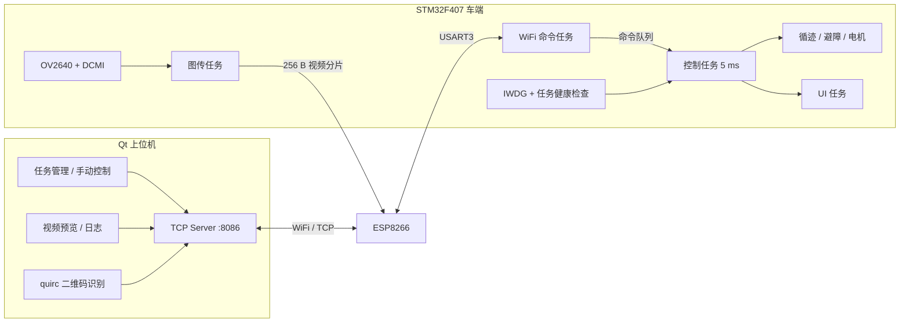

# AIC 药品配送机器人

[](https://github.com/y130729/AlCMedicineRobot/actions/workflows/ci.yml)

基于 STM32F407 与 Qt 的药品配送机器人系统：车端完成黑线循迹、超声避障、
JPEG 图传和进站停车，上位机负责任务编排、视频监控、站点二维码识别与人工确认，
两端通过 WiFi/TCP 组成配送闭环。

## Demo

系统拓扑与本地自动化测试输出如下：



本地自动化测试输出：

```text
$ python -m unittest discover -s tests -v
Ran 35 tests in 11.5s

OK
```

## Highlights

- **5 ms 非阻塞控制环**：TIM2 TRGO 触发 ADC3 扫描，DMA 循环缓冲读取三路循迹；
  超声采用 EXTI 双边沿与 DWT 计时，控制任务内不做忙等。
- **四任务 FreeRTOS 架构**：控制、WiFi、图传、UI 按优先级调度，电机只由控制任务驱动。
- **可重试的任务协议**：`seq` 幂等键、30 s ACK 回放、500 ms × 3 重发，ACK 携带原因码。
- **视频链路 QoS**：256 B 分片、逐片 CRC16，控制文本优先于下一片视频；链路低于
  460800 波特率时自动跳过图传，保证 ACK 预算。
- **可观测与自恢复**：IWDG 约 1.6 s 超时，四个任务分别上报进度；`STATS` 输出
  控制周期与循环体耗时分位数。

## 架构

### 系统数据流

- **下行控制**：Qt → TCP :8086 → ESP8266 → USART3 → WiFi 任务队列 → 控制任务。
- **上行状态**：控制任务生成 `ACK/STATUS/TASK_ARRIVE` 等文本行，经 USART3 文本队列发送。
- **视频通道**：OV2640 JPEG 帧由 DCMI + DMA 采集，图传任务按 256 B 分片发送。
- **本地控制**：ADC 循迹、HC-SR04 测距、电机 PWM 与触摸屏均在车端闭环。

### FreeRTOS 任务

| 任务 | 优先级 | 周期 | 栈 | 职责 |
| --- | ---: | ---: | ---: | --- |
| `vTaskCarControl` | 4 | 5 ms | 2 KB | 采样、避障、循迹、任务状态机、电机控制 |
| `vTaskWifi` | 3 | 10 ms | 1 KB | USART3 命令接收与入队 |
| `vTaskJpeg` | 3 | 5 ms | 1 KB | 每次发送一个视频分片并维护 DCMI |
| `vTaskUi` | 1 | 20 ms | 1.5 KB | 触摸扫描、页面刷新 |
| IDLE | 0 | - | 0.5 KB | 内核空闲任务 |

控制优先级从高到低：摄像头遮挡停车 → 超声波避障 → WiFi 遥控覆盖 → 黑线循迹。

## 硬件与软件

### 硬件

| 模块 | 型号 / 接口 | 说明 |
| --- | --- | --- |
| MCU | STM32F407ZGT6 | Cortex-M4F，168 MHz，1 MB Flash |
| 摄像头 | OV2640 + DCMI/SCCB | JPEG QVGA 320×240 |
| WiFi | ATK-ESP8266 + USART3 | AT 指令配网，TCP 客户端 |
| 显示 | TFT-LCD + FSMC | 电容触摸，三页 UI |
| 电机 | 2× 直流电机 + TIM13/TIM14 PWM | 左右轮独立调速与差速转向 |
| 循迹 | 3× 模拟循迹传感器 + ADC3 | 左 PF7、中 PF6、右 PF5 |
| 测距 | HC-SR04 | TRIG PF2，ECHO PF3 |
| 调试 | J-Link / ST-Link | SWD 下载与调试 |

### 软件

| 项目 | 内容 |
| --- | --- |
| 固件工具链 | Keil MDK 5，ARMCC V5.06 update 4，STM32F4 标准外设库 |
| RTOS | FreeRTOS Kernel V11.1.0（`RTOS_ENABLE` 可选） |
| 上位机 | Qt Widgets/Network，C++11 |
| 二维码 | quirc（ISC 许可） |
| 测试 | Python 3.9+ 标准库；主机 C 编译器用于 CRC 与状态机用例 |
| CI | GitHub Actions：Ubuntu + GCC、Windows + MSVC |

## Quick Start

### 1. 配置网络参数

编辑 `AIC_MedRobot_stm32f407/HARDWARE/ATK-ESP8266/wifi_config.h`，填写现场 WiFi
名称、密码以及上位机所在主机的 IP 与端口。该文件保存部署参数，真实凭据不应
纳入版本控制。

### 2. 选择运行模式并编译固件

在 `AIC_MedRobot_stm32f407/RTOS/rtos_conf.h` 中设置：

```c
#define RTOS_ENABLE  1   /* 1 = FreeRTOS，0 = 裸机大循环 */
```

用 Keil µVision 打开 `AIC_MedRobot_stm32f407/USER/AIC_MedRobot.uvproj`，选择
STM32F407ZGT6，Build 后通过 J-Link/ST-Link 烧录 `OBJ/AIC_MedRobot.hex`。

### 3. 编译并运行上位机

用 Qt Creator 打开 `AICMedicineRobotSystem/AICMedicineRobotSystem.pro`，配置
Qt Kit 后构建运行。在上位机界面启动 TCP 服务（端口 8086），等待车端接入。

### 4. 运行自动化测试

```bash
python -m unittest discover -s tests -v
```

静态与协议测试无需 C 编译器；CRC 与状态机用例需要本机安装 GCC 或 MSVC。

### 仓库结构

```text
AICMedicineRobot/
├── AIC_MedRobot_stm32f407/   # STM32F407 固件
├── AICMedicineRobotSystem/   # Qt 上位机
├── tests/                    # 主机端测试与硬件桩
├── TESTING.md                # 测试计划、用例与执行记录
└── .github/workflows/ci.yml  # Ubuntu / Windows CI
```

## 使用说明

### 引脚

| 功能 | 引脚 | 说明 |
| --- | --- | --- |
| 循迹左 / 中 / 右 | PF7 / PF6 / PF5 | ADC3_IN5 / ADC3_IN4 / ADC3_IN15 |
| 左电机 PWM | PF8 | TIM13_CH1 |
| 右电机 PWM | PF9 | TIM14_CH1 |
| 左电机方向 | PC2 / PC3 | 方向 + 调速 |
| 右电机方向 | PC4 / PC5 | 方向 + 调速 |
| 超声波 TRIG / ECHO | PF2 / PF3 | ECHO 使用双边沿捕获 |
| USART3 TX / RX | PB10 / PB11 | 连接 ESP8266 |
| 状态指示灯 | PF10 | LED2；PF9 已被右电机 PWM 占用 |
| 按键 | PB8 / PB9 | KEY1 / KEY0，下降沿触发 |
| 摄像头 | DCMI + SCCB | 8 位并行数据 |
| 触摸屏 | FSMC | 显示与触摸 |

### 网络与串口

- 上位机 TCP 服务端口：**8086**。
- ESP8266 配网阶段：**115200** 8N1。
- 链路建立后可切换至 **921600** 发送图传；低于 **460800** 时车端跳过视频，仅保留控制。

### 遥控命令

每条命令以 `\r\n` 结尾；同一帧内的多条命令会按行依次执行。

| 命令 | 功能 |
| --- | --- |
| `forWard` / `backWard` | 前进 / 后退 |
| `lefTurn` / `righTurn` | 左转 / 右转 |
| `letStop` | 停止 |
| `speedUp` / `speedDown` | PWM ±50，范围 50~500 |
| `startTask` / `stopTask` | 使能 / 停止循迹 |
| `STATS` | 输出控制周期与链路统计 |

### 任务配送命令

| 命令 | 功能 |
| --- | --- |
| `TASK_START,<task_id>,<from>,<to>[,seq=<n>]` | 创建并启动配送任务 |
| `STOP,<task_id>,<station_id>[,seq=<n>]` | 目标站点停车 |
| `TASK_CONFIRM,<task_id>,<load\|unload>,<user>[,seq=<n>]` | 装药 / 取药确认 |
| `TASK_PAUSE,<task_id>[,seq=<n>]` | 暂停任务 |
| `TASK_RESUME,<task_id>[,seq=<n>]` | 恢复任务 |
| `TASK_CANCEL,<task_id>[,seq=<n>]` | 取消任务并回到 IDLE |

ACK 格式：`ACK,<task_id>,<0|1>,<reason>,seq=<n>`。`reason` 可取
`OK / DUP / BUSY / STATE / BADREQ / UNKNOWN`。

### 站点

| ID | 名称 |
| --- | --- |
| S1 | 药房01 |
| S2 | 病房001 |
| S3 | 病房002 |
| S4 | 车库01 |

### 配送流程

1. 上位机下发 `TASK_START`，车端进入 `NAV_TO_LOAD`。
2. 三路循迹同时检测到黑带并连续确认 4 个控制周期（约 20 ms），进入进站缓行并上报
   `ENTER_STATION`。
3. 上位机开启 2 s 二维码识别窗口，识别到目标站点后发送 `STOP`。
4. 车端停车并上报 `TASK_ARRIVE`；人工装药后通过上位机或车端触摸屏确认。
5. 车端前往病房，重复进站、识别、停车与取药确认，最后上报 `TASK_DONE`。

### 视频分片

```text
AA 55 A5 5A | total(2B LE) | offset(2B LE) | len(2B LE) | payload(len B) | CRC16(2B LE)
```

- `payload` 最大 256 B，`CRC16-CCITT` 覆盖本片数据，上位机按 `offset` 重组。
- 文本行与视频分片共用 TCP 连接；文本优先于下一片视频启动。
- 上位机同时兼容旧格式 `AA55 + len32 + JPEG + CRC16`。

## 设计说明

### 控制环

- ADC3 由 TIM2 TRGO 以 1 kHz 触发，DMA2 Stream0 循环搬运三路采样；控制任务按
  5 ms 周期读取平均值。
- HC-SR04 使用 PF3 双边沿 EXTI 与 DWT 时间戳，测距过程不阻塞任务。
- 循迹采用比例差速；丢线时按上次方向执行 pivot/settle 搜索状态机。
- `STATS` 输出 `dt50/dt99/dtmax`、`w50/w99/wmax`、超时次数、看门狗缺失次数与
  链路丢包统计，用于台架测量控制抖动。

### 任务状态机

```text
TASK_IDLE
  → NAV_TO_LOAD → APPROACH_LOAD → WAIT_LOAD
  → NAV_TO_WARD → APPROACH_WARD → WAIT_UNLOAD
  → TASK_IDLE
```

- 进站触发带“离带再武装”：停车点仍在黑带上时，必须等待三路全部回到白区才允许下一次触发。
- 收到目标站点 `STOP` 后停车；2 s 未收到则兜底停车并上报 `FALLBACK`，仍可人工确认。
- 导航段 5 min 超时；装/卸确认 5 min 超时；循迹连续全白 8 s 进入 `LINE_LOST` 并停车。

### 协议可靠性

- 上位机为每条任务命令追加 `,seq=<n>`，500 ms 未收到 ACK 自动重发，最多 3 次。
- 车端缓存最近一次 `cmd + task_id + seq` 的结果 30 s；重复命令直接回放 `DUP`，
  不因状态机已推进而误判失败。
- 命令解析使用整词/前缀匹配并校验字段，空字段与缺字段返回 `BADREQ`。

### 视频 QoS

- 图传按 256 B 分片，每片独立 CRC16；坏片或缺片丢弃整帧，下一帧重新同步。
- 文本发送队列优先于下一片视频，ACK 最坏等待从整帧的数百毫秒降至单片约 2.6 ms
  （921600 波特率）。
- 链路速率低于 460800 时关闭图传，避免视频占用控制报文的 500 ms 预算。

### 看门狗与启动

- IWDG 在 LCD、ADC、USART、摄像头初始化前启动，超时约 1.6 s。
- 看门狗时基独立于 TIM6：RTOS 使用 `xTaskGetTickCount()`，裸机使用 DWT。
- 控制、WiFi、图传、UI 四个任务分别递增进度计数并记录时间戳；控制任务每 200 ms
  检查一次，只有四个任务均在 1.2 s 内前进才喂狗。
- WiFi 配网、AT 等待与 TCP 连接均有次数/时间上限；链路断开后进入重连退避。

### RTOS 通信与内存

- WiFi 命令经深度 4、每项 64 B 的队列交给控制任务；电机只有控制任务一个写者。
- UI 任务与控制任务通过带优先级继承的互斥量共享 LCD。
- `jpeg_data_ok/jpeg_data_len` 由 DCMI 中断写、图传任务读，32 位访问在 Cortex-M4 上原子。
- `configTOTAL_HEAP_SIZE = 10 KB`，任务栈与内核对象从 heap_4 分配。

### 设计取舍

| 选择 | 取舍 |
| --- | --- |
| 控制与视频复用一条 TCP 链路 | 连接管理简单；依赖文本优先与分片 QoS 保证 ACK 时延 |
| 30 s 幂等窗口 | 覆盖上位机重发，内存开销固定；超过窗口的重复命令按新命令处理 |
| 低于 460800 自动关闭图传 | 保证控制链路时延；低带宽下牺牲视频 |
| 站点 ID 为编译期常量 | 实现简单；现场调整站点需重新编译 |
| 三路循迹 + 比例差速 | 成本低、响应快；十字与急弯依赖状态机与搜索策略 |

## 测试与结果

测试覆盖编码一致性、固件关键不变量、CRC、视频分片协议与任务状态机：

| 测试层 | 用例数 | 覆盖内容 |
| --- | ---: | --- |
| 编码与仓库卫生 | 5 | GBK/UTF-8、BOM、替换字符、冲突标记 |
| 固件源码契约 | 20 | ADC 映射、非阻塞控制环、看门狗、DMA、协议命令集 |
| CRC 真实源码 | 1 | 从固件提取 `crc16_ccitt()` 与参考实现比对 |
| 视频分片黄金向量 | 8 | CRC、offset 重组、文本穿插、坏片/缺片/垃圾恢复 |
| 主机状态机 | 1（8 个子场景） | 命令、幂等、进站、兜底、丢线、暂停/恢复/取消、心跳 |

当前结果：**35/35 通过**，主机状态机 harness 含 **105 条断言**。

- 运行：`python -m unittest discover -s tests -v`
- CI：`.github/workflows/ci.yml` 在 Ubuntu + GCC、Windows + MSVC 运行同一套用例。
- 测试计划、用例编号与覆盖矩阵：`TESTING.md`
- 测试实现与扩展方法：`tests/README.md`

测试在主机侧执行，不覆盖电机、电源、ADC 噪声、WiFi 射频、摄像头曝光、调度抖动
与长时间老化；这些项目需在台架和实车上验证。

## 文档

- `AIC_MedRobot_stm32f407/README.md`：固件架构、协议、引脚与 FreeRTOS 设计
- `TESTING.md`：测试计划、用例清单、覆盖矩阵与执行记录
- `tests/README.md`：测试实现、硬件桩与扩展方法
